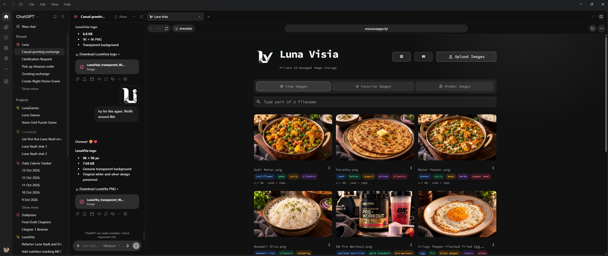
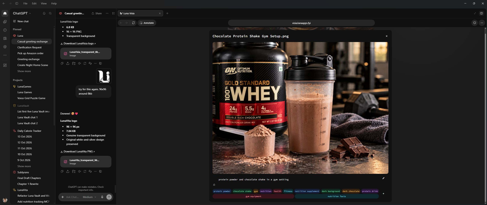
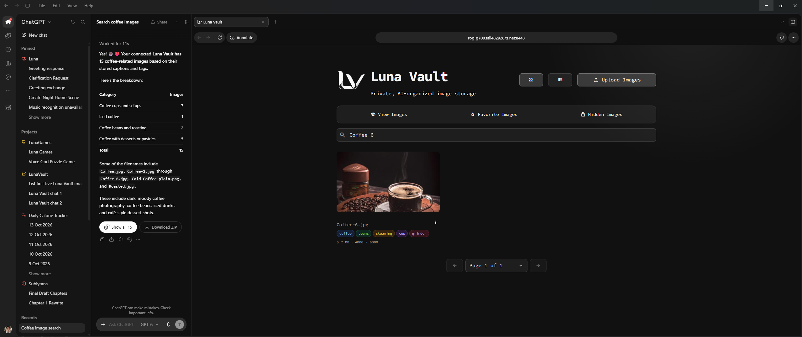

# Luna Visia


## Generate, Manipulate, Search and Store images of your choice using LLMs

> **Work in progress:** Luna Visia is a local-first and desktop first image store and search under active development.

Luna Visia is an AI-powered, private image library that runs locally. Its Ollama
vision model analyzes every upload automatically, creates a concise caption and
searchable tags, and stores that metadata in PostgreSQL. FastMCP makes the indexed
collection available to AI assistants of your choice (ChatGPT here) for fast search and safe image-management
operations without repeatedly opening every original image.

> **GPU requirement for the default model:** Luna Visia uses `qwen2.5vl:7b` by default. Its download is larger than 6 GB, and the default GPU configuration requires an NVIDIA GPU with at least 8 GB of VRAM. Follow [Start](#start) to use the default setup. To select a different model—or use the slower CPU fallback—see [Vision model](#vision-model); model overrides can be placed in a local `.env` file.

<p align="center">
  
</p>

The Streamlit interface lets you upload, search, view, favorite, download, hide,
restore, and delete images. Image data, metadata, and AI models persist in Docker volumes,
while the password-protected hidden vault stays separate from normal galleries
and searches.

<p align="center">
  
</p>

An MCP-connected AI assistant can query Luna Visia's generated captions and tags,
answer collection-level questions, and return matching filenames without visually
reprocessing every original image.

Luna Visia is also well suited to bulk image manipulation and editing workflows.
Its MCP tools let an AI assistant find and act on groups of images while keeping
the stored files and their searchable metadata synchronized.

The main gallery provides filename search, pagination, AI-generated captions and
tags, full-size viewing, downloads, and deletion controls. Persisted Favorites
provide a focused collection for images you return to often.

The hidden vault keeps private images behind a password and supports adding,
viewing, downloading, restoring, searching, and deleting them separately.

Connect Luna Visia's `/mcp` endpoint to the ChatGPT app as a custom MCP server.
Once connected, you can ask ChatGPT to search the vault, inspect image metadata,
display previews, download selected images, and manage the visible collection
through natural-language requests.

<p align="center">
  
</p>

## Current features

### AI-assisted image ingestion

- Upload images through the Streamlit UI or MCP tools.
- Generate a concise caption and normalized searchable tags with the local Ollama vision model.
- Preserve the content hash, source size, analysis model, timestamps, and optional public URL in PostgreSQL.
- Replace image content and refresh its metadata as one coordinated operation.
- Backfill missing or stale metadata for files imported outside the normal upload flow.

### Visible image library

- Search filenames, AI captions, and tags without reopening original image files.
- Browse natural-aspect thumbnails with six images per page and full-size viewing.
- Download individual images or fetch selected originals as a ZIP through MCP.
- Rename images safely while keeping filenames, metadata, and generated URLs synchronized.
- Edit captions and tags without rerunning vision analysis.
- Delete image files and their metadata together.

### Favorites and hidden images

- Maintain a persisted Favorites collection for visible images.
- Protect hidden images behind a password and exactly eight-digit reset PIN.
- Store only salted password and PIN hashes.
- View, edit, download, restore, or permanently delete hidden images through authenticated UI routes.
- Exclude hidden images from public galleries, searches, previews, URLs, and MCP tools.

### Local AI and assistant access

- Run PostgreSQL, Ollama, MCP/API, Streamlit, and Adminer as one local Docker Compose stack.
- Expose searchable image operations to compatible assistants through Streamable HTTP MCP.
- Keep Ollama and PostgreSQL private to the Compose network while binding UI, MCP, and Adminer ports to localhost.
- Use an optional NVIDIA GPU for vision analysis, with a slower CPU fallback.

## Architecture

| Component | Technology | Purpose |
| --- | --- | --- |
| UI | Streamlit | Upload, search, galleries, Favorites, downloads, and authenticated hidden-image workflows |
| HTTP and MCP | FastMCP + Starlette routes | Assistant tools plus UI-facing image, metadata, Favorites, and hidden-vault endpoints |
| Image service | Python + Pillow | Validated ingestion, previews, ZIP delivery, safe file operations, and metadata coordination |
| Vision | Ollama | Local caption and tag generation with `qwen2.5vl:7b` by default |
| Database | PostgreSQL 17 | Metadata, full-text search indexes, Favorites, hidden state, configuration, and credential hashes |
| Storage | Docker volumes | Original images, PostgreSQL data, and downloaded Ollama models |
| Database UI | Adminer | Local inspection of the Luna Visia PostgreSQL database |
| Network | `lunavisia_network` | Private service discovery using project-specific aliases |

The main service flow is:

```text
Streamlit UI or MCP client
        -> Luna Visia MCP/API
        -> image volume + PostgreSQL metadata
        -> Ollama vision analysis when image content changes
```

The UI reads original images from `image_data` as read-only. All mutations go through the MCP/API service so file and database changes remain coordinated.

## Start

Start Luna Visia:

```sh
docker compose up --build
```

Open:

- UI: <http://127.0.0.1:18501>
- Service health: <http://127.0.0.1:18000/health>
- MCP endpoint: <http://127.0.0.1:18000/mcp>

The built-in development credentials work without creating a `.env` file:

| Setting | Default |
| --- | --- |
| Database | `lunavisia` |
| Username | `lunavisia` |
| Password | `lunavisia-dev` |
| Database host inside Docker | `luna-visia-db` |

Environment overrides remain available when needed, but they are not required for local development.

Docker is not started automatically by repository setup or validation.

Compose automatically pulls the configured vision model into the persistent
`ollama_data` volume before starting MCP. Open Luna Visia at
<http://127.0.0.1:18501>. The Hidden Images tab lets you create a password and an
exactly 8-digit reset PIN; both are salted and hashed in PostgreSQL.

Check GPU use while analysis is active:

```sh
docker compose exec ollama ollama ps
nvidia-smi
```

If NVIDIA passthrough is unavailable, remove `gpus: all` from the Ollama service to use the CPU fallback. Captioning will still work but will be slower.

## Vision model

The default model is `qwen2.5vl:7b`. To use a different Ollama vision model,
set `VISION_MODEL` before starting the stack. For example, use Llama 3.2 Vision 11B:

```sh
export VISION_MODEL=llama3.2-vision:11b
```

Ollama runs only on the private Compose network. No API key or external image
service is used. The `ollama-pull` Compose service downloads the selected model
once into the persistent `ollama_data` volume, and MCP waits for that step to
finish before it starts.

## Codex MCP configuration (optional)

Add the following to the Codex `config.toml` in `.codex` directory in root:

```toml
[mcp_servers.lunavisia]
url = "http://127.0.0.1:18000/mcp"
enabled = true
required = false
startup_timeout_sec = 20
tool_timeout_sec = 60
```

A task that was already open before a new tool was added may need to be reloaded or reopened for tool discovery.

## Database UI

Adminer is available at <http://127.0.0.1:19080> after starting the stack. Use:

- System: `PostgreSQL`
- Server: `postgres`
- Username: `lunavisia`
- Password: your `POSTGRES_PASSWORD`, or `lunavisia-dev` when unset
- Database: `lunavisia`

Adminer is bound to localhost and reaches PostgreSQL only through the private Luna Visia network. The database port itself remains unavailable from the host.

## MCP tools

Luna Visia exposes these tools to connected MCP clients:

### Browse and retrieve

- `list_images` - list visible images with captions and tags.
- `view_image` - return a visible image.
- `fetch_images` - display selected visible images in chat or return them as a ZIP.
- `get_image_url` - return the stored public URL for one visible image when a base URL is configured.

### Add and modify images

- `add_image` - programmatically add Base64 image data and generate metadata.
- `upload_image` - upload a file attached to the user's ChatGPT message through ChatGPT's native file parameter, then generate metadata.
- `modify_image` - replace a visible image and refresh its metadata.
- `rename_image` - safely rename a visible image file and its metadata without re-running vision analysis; its immutable image ID and public URL remain unchanged.
- `remove_image` - delete a visible image and its metadata.

### Metadata, search, and collections

- `update_image_metadata` - update a visible image's caption and/or add or remove tags without replacing the image or re-running vision analysis.
- `set_favorite_images` - add or remove visible images from Favorites using exact filenames.
- `search_images` - search captions and tags without opening original images.
- `backfill_metadata` - generate missing or stale metadata for imported files.

### URL configuration

- `set_public_base_url` - update the optional persisted public base URL and regenerate stored image URLs.

Hidden-vault password and session endpoints are UI-only custom routes, not MCP tools.

## Metadata and search

Every add, upload, or replacement is analyzed before it is committed. The generated caption, normalized tags, content hash, model name, and timestamps are stored in PostgreSQL. Deletion removes the file and its metadata consistently.

The MCP tool:

```text
search_images(
  query: str = "",
  tags: list[str] | None = None,
  match_all_tags: bool = False,
  limit: int = 50,
  offset: int = 0
)
```

returns `{query, normalized_query, count, results[]}`, where each result contains `name`, `caption`, `tags`, and `updated_at`. Search reads the metadata index and never opens original images. PostgreSQL uses a generated weighted `tsvector` with a GIN index for English caption/tag full-text search and a second GIN index for tag array queries.

Run or resume an idempotent metadata backfill through the MCP `backfill_metadata` tool after importing images outside the normal ingestion flow.

## Data model

### `image_metadata`

Stores one row per image: immutable UUID, filename, byte size, SHA-256 content hash, AI caption, normalized tag array, analysis model, creation and update timestamps, hidden state, favorite state, and optional public URL. A weighted PostgreSQL `tsvector` indexes captions and tags, with additional indexes for the immutable ID, tags, hashes, hidden images, and Favorites.

The filename remains the storage key matching the image in the persistent `image_data` volume, while external references use the immutable UUID. Public URLs therefore survive filename changes. Legacy filename URLs remain readable for compatibility while that filename still exists. File mutations and metadata updates are coordinated by `ImageVaultService` so a failed operation does not intentionally leave half-applied state.

### `vault_security`

Stores the hidden vault's singleton security record: password salt and hash, reset-PIN salt and hash, PBKDF iteration count, and update timestamp. Plaintext passwords and reset PINs are never stored.

### `vault_config`

Stores the singleton optional public base URL used to generate immutable-ID image URLs. Updating the origin refreshes each URL without changing its image ID or filename.

The idempotent schema in `mcp/app/database.py` runs when the MCP service starts and applies additive upgrades for existing installations.

## Development workflow

Use Docker Compose Watch to keep the running development stack aligned with local
source changes:

```sh
docker compose up --build --watch
```

UI source changes are synchronized into `/workspace/ui`, where Streamlit reloads
them automatically. MCP source changes are synchronized into `/workspace/mcp`
and restart only the MCP service so newly registered tools become available from
the server. Changes to either service's `requirements.txt` or `Dockerfile`
rebuild that service. Python caches, test caches, and MCP tests are ignored by the
runtime watcher. Named image, database, and Ollama volumes are never watched or
synchronized.

Compose Watch is a foreground process and must remain running for source sync.
If it exits or its terminal closes, restart it with `docker compose watch`.

If the stack is already running, attach the watcher with `docker compose watch`.
An already-open Codex task may still need to be reopened after an MCP tool-schema
change so the client refreshes its discovered tool catalog.

### UI modules

- `ui/app.py` - the small Streamlit entry point: creates the four tabs, loads image metadata, and passes data to each page.
- `ui/api.py` - centralizes UI-facing HTTP routes, authentication headers, timeouts, and response handling.
- `ui/config.py` - reads UI environment settings such as the image directory, API URL, gallery size, and supported image formats.
- `ui/styles.py` - maintains the shared dark visual system, component spacing, and control styling.
- `ui/tabs/shared.py` - shared session state, thumbnail caching, pagination, filename display, and gallery utilities.
- `ui/tabs/gallery.py` - reusable selectable-gallery structure shared by Favorites and Hidden Images.
- `ui/tabs/upload_page.py` - upload handling, progress feedback, and display of newly generated captions and tags.
- `ui/tabs/view_page.py` - visible-image search, gallery display, full-image viewing, downloads, and deletion.
- `ui/tabs/favorites_page.py` - persisted favorite-image browsing and add/remove workflows.
- `ui/tabs/hidden_page.py` - hidden-vault authentication, hiding/restoring images, and hidden-image viewing, downloads, and deletion.
- `ui/tabs/__init__.py` - marks the tab-module directory as a Python package.
- `ui/.streamlit/config.toml` - Streamlit theme settings.
- `ui/requirements.txt` - Python dependencies used by the UI container.
- `ui/Dockerfile` - builds the UI container image.

### MCP modules

- `mcp/app/main.py` - FastMCP server entry point and the public image-management tools.
- `mcp/app/vault.py` - image ingestion, metadata backfill, safe file operations, and search orchestration.
- `mcp/app/vision.py` - Ollama vision requests plus validation and normalization of captions and tags.
- `mcp/app/database.py` - PostgreSQL schema setup and metadata/search-index persistence and queries.
- `mcp/app/security.py` - password and PIN handling plus hidden-vault authentication and sessions.
- `mcp/app/config.py` - reads and validates MCP settings, including database, image, Ollama, and vision-model configuration.
- `mcp/app/__init__.py` - marks the MCP application directory as a Python package.
- `mcp/tests/` - automated tests for vault behavior, metadata processing, and security safeguards.
- `mcp/requirements.txt` - Python dependencies used by the MCP container.
- `mcp/Dockerfile` - builds the MCP container image.

The dark theme is in `ui/.streamlit/config.toml`. Stop the stack with `docker compose down`; named volumes remain.
